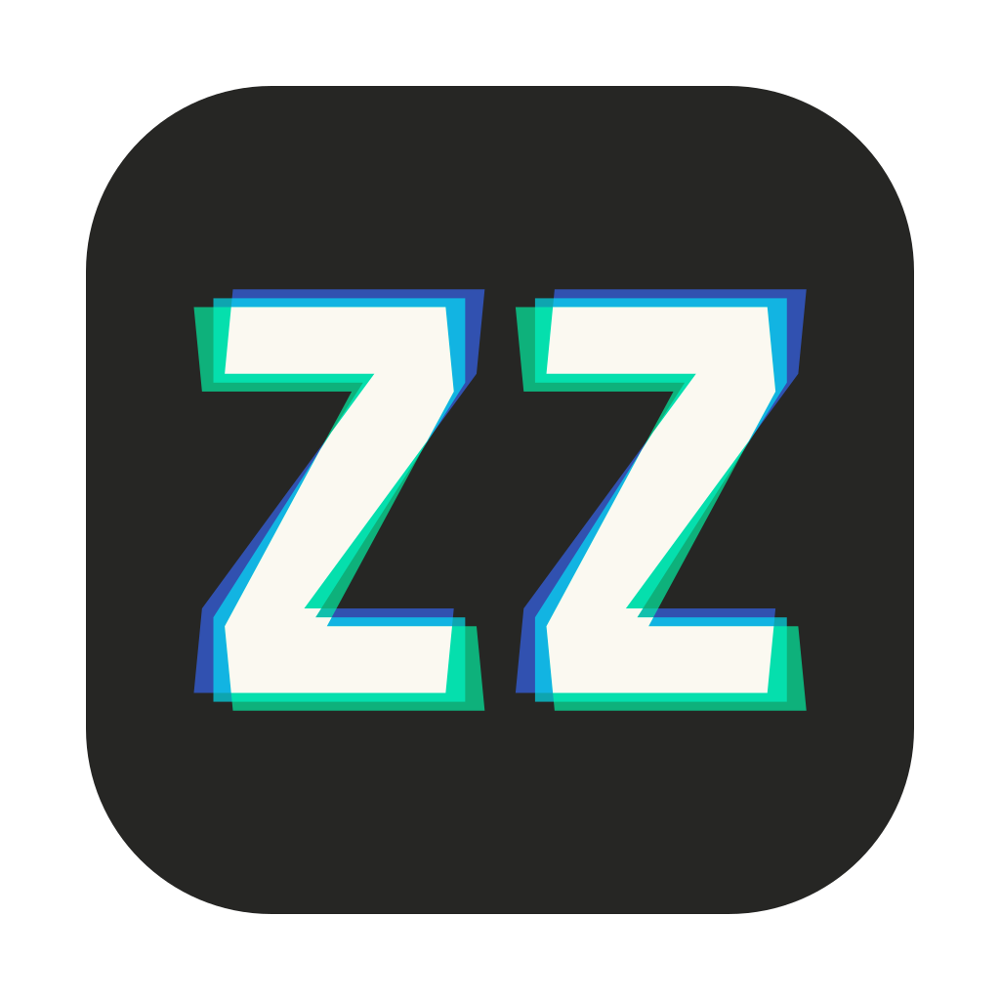
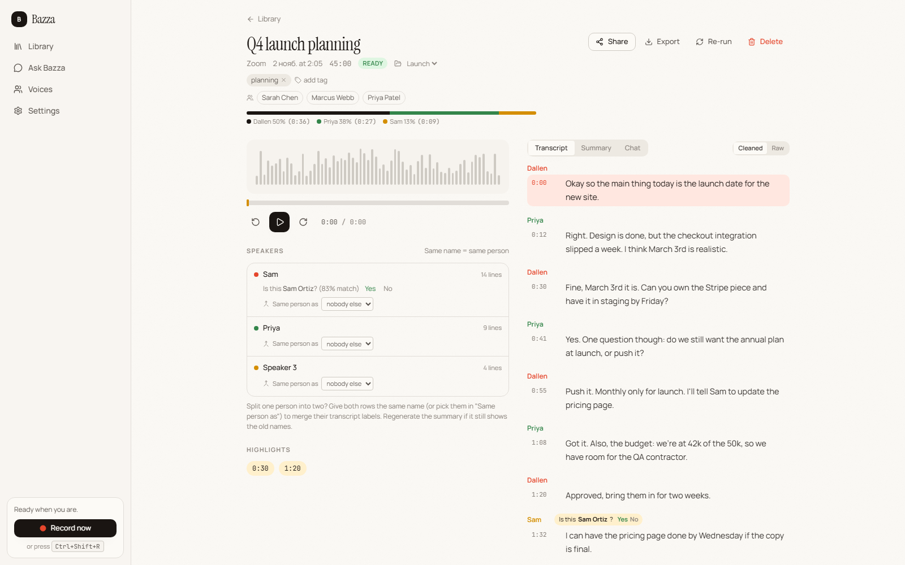
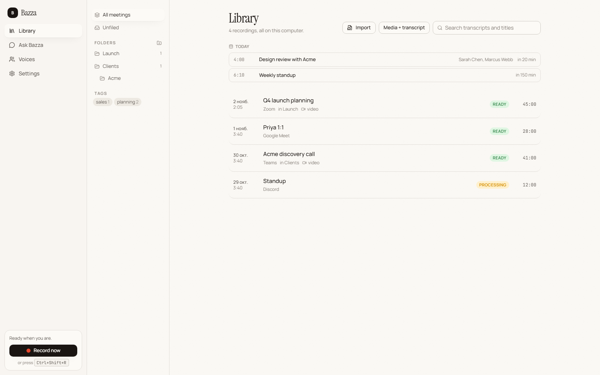

# Bazza

**A free, open-source meeting recorder with local processing by default.**

Bazza notices when you're in a call and offers a **Record** button. It records your mic, sound from the selected audio output and optional video from one screen. It keeps the library on your computer. Local models provide captions, speaker labels, summaries and chat. No mandatory Bazza account or meeting bot. External processing is optional and explicit. See [Privacy](docs/privacy.md).

> Think of it as an open-source, offline alternative to Fathom, Otter and Fireflies.

This is a **local development copy** of [Dallenlol/hark](https://github.com/Dallenlol/hark).
Source changes and development documentation stay on this computer. Remote forks,
pushes, PRs and publication are outside the current scope. For development, start
with [AGENTS.md](AGENTS.md) or the [development index](docs/dev/README.md).
The [fork guide](docs/dev/fork.md) covers local upstream updates and inherited app
identity, data paths and updates. An independent distribution is optional future
work and is not authorized. Bazza has no public installer or automatic update channel.

This local fork also prepares FPS/height controls,
validated `.bazza` and SRT/WebVTT imports, managed voice samples, optional Soniox,
and explicit Codex/Claude Code summaries. Software checks are recorded in the
[implementation report](docs/dev/test-reports/2026-11-01-independent-product-work.md);
hardware, model and service acceptance remains separate from compilation/tests.



## What it does

- **Notices calls** in Zoom, Teams, Google Meet, Webex, Discord, Slack huddles, FaceTime, GoToMeeting, Whereby, Jitsi, Around, Skype, RingCentral, WhatsApp/Telegram/Signal calls - native or in a browser tab - and anything else via audio activity. Shows a small **Record?** popup; a global hotkey and tray menu open the same picker anytime.
- **Records separate Google Meet tracks** when you enable your Attendee bot for a recording. Bazza stores each speaker's WAV and display name locally. [Google Meet setup](docs/dev/attendee-integration.md).
- **Shows what will be recorded.** The picker displays the microphone and the audio output. Sound played on that output is included, from calls and shared media to notifications. With video enabled, select a screen if several are connected.
- **Records** to disk continuously as separate tracks (mic, system, mix) plus optional screen video. If the audio device changes mid-call Bazza switches to the current one and keeps going; a recording interrupted by a crash is finished automatically on the next launch.
- **Shows the meeting live.** Open the recording from the Library while it runs: captions land as people talk (the current line refines in place) and running notes - what's being discussed, decisions and action items so far - update a minute or two after new lines arrive.
- **Transcribes** with a full pass after the call, with **speaker labels**, in English or 30 other languages. Speaker detection runs across all your cores in parallel while whisper transcribes, so it never adds to the wait. Name a speaker once; Bazza recognises their voice next time and asks you to confirm, and Ask Bazza and the summary pick up the name. Split one person into two? Give both the same name and they merge everywhere. Attendee names from the meeting window or your calendar are offered as you type.
- **Cleans up** messy transcripts with a local language model: bad mics, broken English, filler. The raw transcript is always kept.
- **Summarises** instantly from editable templates (general, sales call, client discovery, 1:1, standup, interview), condensing long meetings part by part so nothing is dropped. Titles itself from the content.
- **Imports files** you already have - a phone voice memo, an old Zoom .mp4 - and treats them like a recording. [Media plus a finished SRT/WebVTT transcript](docs/import.md) can be imported without re-transcription.
- **Drafts the follow-up email** from the notes, and exports transcripts as .txt / .srt / .md. Shows who spoke how much.
- **Answers questions** ("Ask Bazza") about one meeting or your whole library with hybrid keyword + semantic search, citing timestamps you can click.
- **Organises** with folders, tags, search, highlights and clips.
- **Shares** via links on your network, `.bazza` bundles you can import on another computer, or a standalone web page. An opt-in webhook pushes finished meetings to Zapier, n8n, Make or your own script.
- **Knows your calendar** from private .ics links (Google, Outlook): recordings take the event's name and attendees.
- **Local builds.** Automatic updates are disabled until an independent signed channel is configured.



## Install

Build Bazza locally for Windows (CPU or CUDA) or macOS (Apple Silicon or Intel).
See [docs/install.md](docs/install.md). Upstream releases remain a separate product.

## Status

Source version: **0.4.0**. See [CHANGELOG.md](CHANGELOG.md).

## Principles

- **Manual by design.** Detection only shows a popup. Recording, speaker names, and sharing all require a click.
- **Local first.** Recordings, transcripts, summaries and chat live in one folder you can back up or move. Model downloads are verified by checksum; updates and user-configured network features are described in [Privacy](docs/privacy.md).
- **Lightweight.** A Tauri app (Rust + React). Idle, it's a tray icon and a 2-second window poll. Models load only when needed.
- **Runs on real hardware.** Model sizes are picked for your machine, and on CPU-only machines Bazza measures each speech model's real speed and picks the best one that finishes within the recording's own length. A GPU makes everything several times faster.

## Building from source

Requirements: [Rust](https://rustup.rs) (stable), [Node 22+](https://nodejs.org) with [pnpm](https://pnpm.io), CMake, a C++ toolchain (MSVC Build Tools on Windows, Xcode CLT on macOS), and libclang (LLVM) for the whisper.cpp bindings.

```bash
pnpm install --frozen-lockfile
node scripts/prepare-bundle.mjs --profile dev   # downloads ffmpeg, builds the diarization sidecar, collects runtime libs
pnpm tauri dev
```

Installers: `node scripts/prepare-bundle.mjs && pnpm tauri build` for the CPU build. For the Windows CUDA build run both steps with `--features cuda` (CUDA 13 toolkit installed, `CUDA_PATH` set - the cuBLAS runtime is bundled), ideally in its own target directory: `CARGO_TARGET_DIR=target-cuda`. On macOS use `--features metal`. The CPU build targets AVX2 (see `.cargo/config.toml`), never the build machine's own CPU.

Focused checks and native test setup: [testing guide](docs/dev/testing.md).

```bash
node scripts/check-docs.mjs
pnpm typecheck
pnpm test
```

## Data location

- Windows: `%APPDATA%\Bazza`
- macOS: `~/Library/Application Support/Bazza`

Inside: `bazza.db` (SQLite), `models/`, and `recordings/<meeting-id>/` with `mic.wav`, `sys.wav`, `mix.wav` and `screen.mp4`. Imported files get the same layout (`mix.wav` converted from the source). Logs: `%LOCALAPPDATA%\app.bazza.desktop\logs\Bazza.log` on Windows.

Bazza uses only `bazza.db` and its own `data-dir.txt` redirect. Portable bundles
must have the `.bazza` extension and a manifest identifying Bazza. Settings > Data >
Change folder copies into an empty destination and leaves the source library intact.

## Docs

[Documentation index](docs/README.md) - [Install](docs/install.md) - [Models and hardware](docs/models.md) - [Privacy](docs/privacy.md) - [FAQ](docs/faq.md) - [Development](docs/dev/README.md)

## Contributing

See [CONTRIBUTING.md](CONTRIBUTING.md) for the local development workflow. Preserve
the "manual by design" and "local first" principles and original attribution.

## License

MIT
