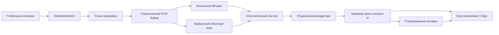

# Системная диктовка для Bazza: исследование и проект интеграции

Дата: 2 ноября 2026 года. Статус: исследование; описанная функция ещё не реализована. Проверены публичные первоисточники и текущее локальное рабочее дерево Bazza. Чужие приложения не запускались, аудио не записывалось, запросы распознавания в облако не отправлялись.

[Development index](../README.md) · [Архитектура](../architecture.md) · [STT](../stt.md) · [Privacy](../../privacy.md)

Порядок будущей реализации, зависимости этапов и критерии готовности: [план диктовки](../plans/2026-11-02-system-dictation.md). Реализация ещё не начата.

## Вывод и рекомендуемое решение

Системную диктовку с выбором локальной или облачной модели можно встроить в существующий Bazza. Для первого рабочего варианта уже есть оба распознавателя: **Whisper локально и Soniox в облаке**. Основная новая работа — отдельная сессия микрофона, глобальные клавиши, индикатор без захвата фокуса и надёжная вставка в другое приложение.

Рекомендация: сохранить собственные capture/ASR/model-download механизмы Bazza, использовать **Handy как основной референс Tauri/Rust для системного ввода**, а **OpenWhispr — для сравнения нативной вставки и организации local/cloud**. Переносить приложение целиком или вводить второй meeting pipeline не требуется. Лицензии и конкретные ревизии доноров перечислены ниже; их наличие не означает, что код уже интегрирован или проверен на этом компьютере.

Первый продуктовый срез: **Windows → настраиваемая клавиша → только микрофон → выбранный Whisper/Soniox → окончательный текст → одна вставка → возможность скопировать результат при неудаче**. Затем тот же контракт реализуется на macOS. Hold-to-talk и toggle нужны как режимы; для первого прототипа toggle сокращает число состояний, а поддержка Pressed/Released закладывается сразу.

«В любые поля» следует определить как широкий набор обычных редактируемых полей с проверенной совместимостью. Защищённый рабочий стол, password-поля, приложения с большими привилегиями и произвольные нестандартные редакторы не дают универсальной гарантии. Для неподдержанного поля результат остаётся доступным для ручного копирования.

## Что действительно известно о Wispr Flow

Wispr Flow — закрытый продукт. Из публичных документов можно установить наблюдаемое поведение, но нельзя достоверно восстановить его внутренний код, точную ASR/LLM модель или весь алгоритм вставки.

- На desktop есть push-to-talk, hands-free/toggle и отмена. Результат вставляется после завершения речи в сфокусированное поле. Это UX-референс для жизненного цикла. [Начало диктовки](https://docs.wisprflow.ai/articles/6409258247-starting-your-first-dictation).
- Распознавание выполняется в облаке; режимы приватности и хранения не превращают его в локальный ASR. [Security overview](https://docs.wisprflow.ai/articles/3467817258-security-and-compliance-faq).
- Flow документирует вставку через буфер, отложенное восстановление поддержанных форматов, сохранение новой пользовательской копии и ограничения elevated-приложений. Следовательно, clipboard/focus recovery — полноценный компонент продукта. [Ограничения вставки](https://docs.wisprflow.ai/articles/1621472516-flow-fails-to-detect-text-fields-or-inserts-incorrectly-on-non-qwerty-keyboard-layouts).
- Чтение контекста из текущего приложения — отдельная возможность. Для Bazza такой доступ следует проектировать отдельно от разрешения на микрофон и отдельно от отправки контекста провайдеру. [Privacy](https://wisprflow.ai/privacy).

Архитектура ниже — предложение для Bazza, выведенное из этих требований и открытых реализаций; это не описание непубличного устройства Flow.

## Что можно переиспользовать в Bazza

Источник истины здесь — исходники текущего рабочего дерева, в котором уже были многочисленные изменения до исследования. Ссылки указывают на существующие файлы, а не на новый код.

| Возможность | Что есть | Как использовать для диктовки |
| --- | --- | --- |
| Локальный ASR | `WhisperEngine::transcribe_opts`, mono f32 16 kHz, язык/auto и prompt | Распознавать ограниченный буфер после Stop; получать движок из существующего кэша. [whisper.rs](../../../crates/bazza-asr/src/whisper.rs), [state.rs](../../../src-tauri/src/state.rs) |
| Облачный ASR | `SonioxWorker`, PCM-канал, события partial/final, отмена, replay/finalization | Новый session sink для диктовки, без записи captions встречи. [soniox.rs](../../../crates/bazza-asr/src/soniox.rs), [provider.rs](../../../crates/bazza-asr/src/provider.rs) |
| Захват только микрофона | `open_microphone_timed(...) -> InputStream` | Открывать отдельно от Recorder/Meeting, складывать PCM в bounded buffer/channel. [stream.rs](../../../crates/bazza-capture/src/stream.rs) |
| Устройства | Stable device IDs и default-device resolution | Отдельный выбор микрофона или явное наследование. [devices.rs](../../../crates/bazza-capture/src/devices.rs) |
| Загрузка моделей | Каталог Whisper, проверка SHA-256, resume | Сохранить текущий каталог и загрузчик; выбрать отдельную модель диктовки. [catalog.json](../../../crates/bazza-models/catalog.json), [download.rs](../../../crates/bazza-models/src/download.rs) |
| Настройки local/cloud | Local/Soniox, модель, consent, отдельный Soniox key | Добавить независимый блок dictation; ключ можно использовать через общий credential reference. [settings.rs](../../../src-tauri/src/settings.rs), [stt_stage.rs](../../../src-tauri/src/stt_stage.rs) |
| Глобальная клавиша | Tauri global-shortcut, события Pressed/Released доступны | Расширить registry по назначению и обработать отпускание. [shortcuts.rs](../../../src-tauri/src/shortcuts.rs) |
| Вторичные окна | Popup/recordbar, отдельная маршрутизация, transparent/topmost | Создать отдельную DictationBar и проверить платформенное no-activate поведение. [windows.rs](../../../src-tauri/src/windows.rs), [App.tsx](../../../app/src/App.tsx) |
| IPC | Типизированные команды/события и browser mock | Все новые UI-вызовы провести через тот же слой. [ipc.ts](../../../app/src/lib/ipc.ts), [mock.ts](../../../app/src/lib/mock.ts) |

### Реальные ограничения существующей интеграции

1. **Готового системного text-input слоя нет.** Существующий Windows UI Automation читает имена участников; он не реализует вставку в caret, clipboard transaction или проверку цели. [participants.rs](../../../crates/bazza-detect/src/participants.rs).
2. **Регистрация hotkey вызывает `unregister_all()`.** Добавление второго сочетания без рефакторинга приведёт к его снятию при перенастройке первого. Нужны отдельные назначения `meeting_toggle`, `dictation_hold`, `dictation_toggle`, `dictation_cancel` и точечная перерегистрация. [shortcuts.rs](../../../src-tauri/src/shortcuts.rs).
3. **Один slot облачной отмены.** `AppState.cloud_stt_cancel` хранит один token; `register_cloud` отменяет предыдущий. Новая диктовка через этот путь способна остановить облачную расшифровку встречи. Нужны session/purpose-aware tokens и согласованная с запуском отмена всех сессий при удалении общего ключа. [state.rs](../../../src-tauri/src/state.rs), [stt_stage.rs](../../../src-tauri/src/stt_stage.rs).
4. **Meeting orchestration переиспользовать нельзя.** `recorder::start` создаёт встречу и файлы, а `stt_stage::start_live` привязан к `meeting_id`, captions и LiveFeed. Диктовка не должна порождать WAV в библиотеке, видео, diarization, summary, embeddings, webhook или экспорт записи. [recorder.rs](../../../src-tauri/src/recorder.rs), [stt_stage.rs](../../../src-tauri/src/stt_stage.rs).
5. **Meeting PCM — смесь mic+system.** Использование этого канала для диктовки может распознать звук собеседника или приложения. Нужен независимый mic-only источник.
6. **Live Whisper имеет пороги, важные для коротких фраз.** Планировщик live пропускает буферы короче 0,5 s и применяет energy gate; «да», «нет» и тихую речь необходимо проверять отдельно. Для первого среза прямой batch-on-stop проще, чем перенос meeting captions. Это риск по исходникам, а не измеренный дефект диктовки. [live.rs](../../../crates/bazza-asr/src/live.rs), [whisper.rs](../../../crates/bazza-asr/src/whisper.rs).
7. **Тёплый кэш не равен планировщику.** Нужен `busy_guard()` вокруг inference, per-model singleflight для cold load и явный приоритет относительно фоновой обработки. Возможность повторной cold-загрузки следует из последовательности cache-check/load/insert; воспроизведение не проводилось. Meeting auto-pick с минимальным бюджетом 90 s нельзя использовать как latency policy для диктовки. [state.rs](../../../src-tauri/src/state.rs), [asr_pick.rs](../../../src-tauri/src/asr_pick.rs), [processing_jobs.rs](../../../src-tauri/src/processing_jobs.rs).
8. **`focus:false` недостаточно.** Он не доказывает, что показ или клик по оверлею никогда не активирует окно. Нужен платформенный no-activate путь и native-проверка.
9. **LLM endpoint не является STT endpoint.** Существующий OpenAI-compatible backend работает с текстовыми LLM. Для других speech API потребуются новые ASR adapters; одного URL из LLM settings недостаточно.
10. **Ключ не хранится в OS keychain.** Soniox secret отделён от обычных Settings и export, но находится в SQLite; нельзя описывать это как уже реализованное шифрование at rest. [STT](../stt.md).

## Целевая архитектура



`L` и `C` — альтернативные ветви по настройке пользователя, не одновременная отправка. При отключённой редактуре raw text непосредственно поступает к проверке цели. В диаграмме намеренно отсутствует meeting pipeline.

### Распределение ответственности

Предлагаемые новые модули, а не существующие файлы:

| Слой | Ответственность |
| --- | --- |
| `crates/bazza-dictation` | Tauri-free state machine, буфер, merge partial/final, cancellation/timeouts, formatter policy, session/result types |
| `crates/bazza-text-input` | Tauri-free платформенные target snapshot/validation, clipboard transaction, event injection, insertion outcomes; `cfg` Windows/macOS |
| `src-tauri/src/dictation.rs` | Владение сессией, mic stream, разрешения, settings snapshot, engine scheduling, финальная координация вставки |
| `src-tauri/src/commands/dictation.rs` | Команды, регистрация в `lib.rs`, mapping ошибок в UI codes |
| `app/src/windows/DictationBar.tsx` | Индикатор listening/processing, provider/model, cancel, результат и ручное восстановление |
| Существующие `settings.rs`, `shortcuts.rs`, `windows.rs`, `ipc.ts`, `mock.ts` | Новые настройки, registry shortcuts, окно и согласованные DTO |

Не раздувать `bazza-detect` записывающими операциями. Для небольшого MVP pure state machine можно сначала оформить модулем существующего Tauri-free crate; отдельный crate оправдан устойчивой границей, а не количеством файлов.

### Жизненный цикл

```text
idle → starting → listening → finalizing → formatting?
     → ready_to_insert → inserting → completed | recoverable
до dispatch: активный этап → cancelling → cancelled
после dispatch: отмена не отзывает уже отправленный ввод
```

- На старте зафиксировать `session_id`, provider/model/language/format policy и цель вставки. Сначала проверить доступность модели/ключа/согласия, затем явно открыть микрофон.
- Capture callback только передаёт PCM в ограниченный канал; inference, clipboard и ожидание сети работают вне UI/capture thread.
- Для первого среза ограничить длительность фразы, например 120 s: 16 kHz mono f32 — около 7,7 MB PCM. Это проектный лимит; лимит RAM модели считается отдельно. Файл аудио по умолчанию не нужен.
- Partial text показывать только в DictationBar. В чужое поле вставлять один окончательный результат: это избавляет от отката переписанных гипотез.
- Stop завершает захват и получает final. Cancel и финальный переход к dispatch сериализуются общим session gate с повторной проверкой `session_id`/generation непосредственно перед отправкой. Если Cancel победил до dispatch, вставки нет; после dispatch события ОС нельзя универсально отозвать или откатить, UI сообщает `too_late`/исход доставки. Опоздавшие callbacks игнорируются. Все mic handles и workers завершаются предсказуемо.
- Для каждого результата выделить `insertion_id` и разрешить максимум одну **автоматическую попытку**. Ровно однократное появление текста в произвольном чужом приложении недоказуемо; повтор при неопределённом исходе остаётся явным действием.
- Отзыв consent/удаление ключа имеет приоритет над snapshot настроек. Новые допуски к отправке PCM/текста блокируются тем же revocation gate, что согласует регистрацию workers. Уже начавшаяся отправка может завершиться; уже переданные провайдеру данные отменой не возвращаются. UI не должен обещать обратное.

Минимальный предполагаемый IPC:

```text
dictation_start(mode) -> session_id
dictation_stop(session_id) -> accepted
dictation_cancel(session_id) -> accepted
dictation_get_state() -> state
dictation_copy_result(session_id) -> outcome
dictation_insert_result(session_id, explicit_current_target) -> outcome

dictation-state: session_id, phase, provider, model, error_code
dictation-preview: session_id, text, is_final
dictation-result: session_id, insertion_id, raw_text, formatted_text, insertion_outcome
```

`accepted` не означает, что распознавание или вставка уже завершились. Окна фильтруют события по сессии, удаляют listeners; события встречи и диктовки различаются.

## Выбор локальной или облачной модели

Выбор диктовки должен быть независим от настроек встреч: пользователь может оставить встречи локальными и диктовать через Soniox или выбрать обратную комбинацию.

| Настройка | Предлагаемое поведение |
| --- | --- |
| Распознавание | `На устройстве` / конкретный облачный провайдер |
| Локальная модель | Из установленного совместимого каталога; отдельный `dictation.local_model_id` |
| Облачная модель | Валидируемый model ID выбранного провайдера, отдельно от LLM model |
| Язык | Auto/Russian/другой поддержанный; `ru/en` hints там, где API это поддерживает |
| Редактура | Off / локальная / облачная; отдельное разрешение на отправку текста |
| Микрофон | System default или выбранный ID; недоступный fixed ID не подменять молча |
| Режим | Hold-to-talk / toggle; настраиваемое сочетание с проверкой конфликтов |
| История и аудио | По умолчанию не сохранять; последние результаты в памяти с ограниченным сроком |

### Модели первого этапа

| Вариант | Основание выбора | Что ещё требуется проверить |
| --- | --- | --- |
| **Whisper Base/Small** | Уже есть движок и каталог Bazza; кандидаты на быстрый локальный профиль | Короткие RU-фразы, имена, числа, code-switching, cold/warm latency на целевом CPU |
| **Whisper Large v3 Turbo** | Уже есть в каталоге; multilingual-модель, MIT, меньше decoder layers, чем у Large v3 | Ресурсы и задержка на реальном backend Bazza; маркетинговая скорость другой runtime не переносится автоматически. [Model card](https://huggingface.co/openai/whisper-large-v3-turbo) |
| **Soniox `stt-rt-v5`** | Уже реализован streaming adapter; текущий `DEFAULT_MODEL` Bazza — v5 | Надёжное завершение короткой сессии, ошибки сети/ключа/квоты, фактическое качество RU. Официальная страница на дату исследования называет v5 active, v4 — alias. [Models](https://docs.soniox.com/stt/models) |
| **Parakeet TDT 0.6B v3**, следующий этап | Model card включает русский среди 25 языков; веса CC BY 4.0 | Новый совместимый inference adapter, artifacts/checksums, attribution и сравнительный замер. Это не просто загрузка файла в whisper-rs. [NVIDIA model card](https://huggingface.co/nvidia/parakeet-tdt-0.6b-v3) |

Начинать с Whisper + Soniox: так проверка системного ввода не смешивается с внедрением нового ASR runtime. Parakeet v2 и модели с `.en` нельзя автоматически предлагать для русской диктовки по аналогии с v3/multilingual.

Новых cloud adapters, например для совместимого transcription API или другого streaming-провайдера, достаточно добавлять за тем же session contract. Совместимость текстового chat API не доказывает совместимость audio uploads, streaming events, timestamps и отмены. Широкую абстракцию всех провайдеров не нужно делать условием первого результата.

### Завершение облачной диктовки

Soniox различает provisional и final tokens. Partials не должны попадать в окончательную вставку. [Real-time transcription](https://docs.soniox.com/stt/rt/real-time-transcription).

Для первого варианта проще отдельное соединение на диктовку: отправить весь захваченный PCM, закрыть audio input по существующему EOS-пути, дождаться валидного terminal completion. Нельзя считать таймаут подтверждением всех слов или дописывать partial tail как final.

Если позже нужен persistent stream с несколькими фразами, Soniox предоставляет `{"type":"finalize"}` и marker `<fin>`. Это другой рубеж, чем завершение всей connection (`finished`). Документация рекомендует около 200 ms тишины после речи перед manual finalization; механизм надо отдельно реализовать и проверить, не выдавать его за уже имеющийся в Bazza. [Manual finalization](https://docs.soniox.com/stt/rt/manual-finalization).

Endpoint detection может помогать финализировать фрагменты, но пауза не должна самовольно завершать hold/toggle сессию. Для одного диктующего diarization не требуется. [Endpoint detection](https://docs.soniox.com/stt/rt/endpoint-detection).

При сбое выбранного облака показывать ошибку и доступный подтверждённый текст. Предложение «распознать локально» допустимо отдельной кнопкой, если PCM ещё в памяти. При local mode не делать скрытый fallback в облако. Разные провайдеры не должны включаться после ошибки без выбора пользователя.

### Редактура и словарь

Сохранить различие между `raw_text` и `formatted_text`. В первом срезе достаточно пунктуации самого ASR; LLM cleanup не является обязательной частью диктовки.

Для следующего этапа: словарь терминов/имён, режим «дословно», структурирование списков, opt-in app profiles. Soniox принимает структурированный context и terms; Whisper имеет prompt. Это подсказки распознавателю, а не гарантия точного написания. [Soniox context](https://docs.soniox.com/stt/concepts/context), [локальный Whisper](../../../crates/bazza-asr/src/whisper.rs).

Не применять meeting cleanup prompts вслепую: у диктовки важны точные числа, пути, команды, email и смысл оговорок. Любой formatter должен сохранять raw результат и иметь fallback к нему при ошибке. Локальный ASR с облачной редактурой отправляет текст наружу — в UI это отдельная явная комбинация.

## Конкуренция с записью встречи

Для первого среза разумно **отказывать в запуске диктовки во время встречи и наоборот**, с понятным сообщением. Действующую запись не останавливать и её настройки не менять. Проверка должна быть атомарной в общем admission gate: два одновременных Start не должны пройти независимо. Reservation удерживается до завершения всей сессии, включая finalization/formatting/insertion, а не только до Stop микрофона. Pending clipboard restore также должен завершиться или явно передать ownership следующей транзакции.

Переключение библиотеки через `change_data_dir` должно учитывать активную/завершающуюся диктовку: текущие проверки recording/processing_jobs/busy не знают нового lifecycle. Это нужно решить вместе с shutdown и сменой настроек, прежде чем добавлять новую сессию в AppState. [commands/organize.rs](../../../src-tauri/src/commands/organize.rs).

Это ограничение объёма первой реализации, а не утверждение о невозможности совместного доступа к микрофону. После native-измерений можно разрешить два shared-mode capture streams или fan-out одного mic stream. Fan-out требует нового общего владельца устройства; для него сначала нужен baseline существующей записи.

Для параллельного режима отдельно решить:

- registry cloud sessions и область consent/credential revocation;
- CPU/GPU priority, bounded очереди и поведение фоновых processing jobs;
- multiple cold-load requests и память разных моделей;
- остановку stream только после освобождения всех подписчиков;
- конфликт device changes, meters/probe и ошибок драйвера;
- независимость сырого mic от meeting mix и маршрутизации в облако.

Существующий `busy_guard` защищает lifecycle кэша, но не заменяет resource scheduler. Любая переделка capture/fan-out должна начинаться с baseline, как требуют [AGENTS.md](../../../AGENTS.md) и [руководство по проверкам](../testing.md).

## Готовые проекты GitHub

Ниже проверены не только описания, но и LICENSE и перечисленные файлы исходников. Это source review, не runtime-приёмка. Ссылки на код закреплены commit SHA, потому что `main` и лицензии проектов меняются.

| Проект | Лицензия на проверенной ревизии | Полезные реализации | Применимость к Bazza |
| --- | --- | --- | --- |
| **[cjpais/Handy](https://github.com/cjpais/Handy)** | [MIT](https://github.com/cjpais/Handy/blob/889fca0d1cf38d07f0b640478d22341d9c6a9327/LICENSE) | Tauri/Rust, hold/toggle, clipboard/direct typing, Windows/macOS adapters | Основной референс системного ввода. Текущий inference runtime другой; его перенос Bazza не нужен |
| **[OpenWhispr/openwhispr](https://github.com/OpenWhispr/openwhispr)** | [MIT](https://github.com/OpenWhispr/openwhispr/blob/b9e9ebefac4b961456c269164a93ddfdd53438b9/LICENSE) | Local/cloud/self-hosted routing, native C/Swift paste helpers, сохранение Windows target | Второй основной референс; переносить отдельные алгоритмы, без Electron runtime |
| **[amicalhq/amical](https://github.com/amicalhq/amical)** | [MIT](https://github.com/amicalhq/amical/blob/3f24a7aa2b8f609a2b9c4e2c26da330cd37b3f22/LICENSE) | Native Swift/C# helpers, AX context, многоформатный clipboard, reusable worker | Полезен для качества платформенного слоя. Local Whisper в проверенном коде требует macOS 15+; Windows helper не доказывает local ASR на Windows |
| [3choff/dictate](https://github.com/3choff/dictate) | [Apache-2.0](https://github.com/3choff/dictate/blob/a3fc5e367c7dfc8a5daa38bf7eda874a2a3d3a3e/LICENSE) | Tauri/Rust, Enigo, direct typing, cloud providers, no-activate overlay | Компактный пример команд и Windows UX; clipboard snapshot слишком простой для полного восстановления |
| [RhythmicDias/DictateAnywhere](https://github.com/RhythmicDias/DictateAnywhere) | [MIT](https://github.com/RhythmicDias/DictateAnywhere/blob/352c4ddfb9ba79a8aa665e968f78cc3321767072/LICENSE) | Tauri 2/Rust/React + Python, единый STT contract, Win32 Unicode injection | Учебный hybrid-provider пример; Python-sidecar расширит упаковку. В injection есть прямые Win32 imports без platform guards — macOS переносимость не подтверждена |
| [Beingpax/VoiceInk](https://github.com/Beingpax/VoiceInk) | [GPL v3](https://github.com/Beingpax/VoiceInk/blob/19546d2a7f85578f49efb538eb888b37ff2f8f8c/LICENSE) | Native macOS Swift, local/cloud, session-aware clipboard delivery | Архитектура/UX macOS; отдельная категория от permissive-доноров |
| [EpicenterHQ/epicenter — Whispering](https://github.com/EpicenterHQ/epicenter/tree/7cc869b4a1295e2566b61e1a4d5967a89f413b9b/apps/whispering) | [AGPL-3.0-or-later](https://github.com/EpicenterHQ/epicenter/blob/7cc869b4a1295e2566b61e1a4d5967a89f413b9b/LICENSE) | Svelte/Tauri, shortcuts, local runtime, native clipboard borrowing | Референс архитектуры; текущую лицензию нельзя считать MIT по старым обзорам Whispering |

Для текущей MIT-базы выбирать компоненты с проверенной permissive-лицензией и сохранять требуемые notices/атрибуцию. Код GPL/AGPL-проектов не включать напрямую без отдельного решения по лицензированию. Лицензия приложения также не заменяет проверку лицензий зависимостей, bundled helpers и весов модели.

### Handy: конкретные точки для адаптации

- [shortcut/handler.rs](https://github.com/cjpais/Handy/blob/889fca0d1cf38d07f0b640478d22341d9c6a9327/src-tauri/src/shortcut/handler.rs): stateful press/release для push-to-talk, toggle и смешанного режима.
- [clipboard.rs](https://github.com/cjpais/Handy/blob/889fca0d1cf38d07f0b640478d22341d9c6a9327/src-tauri/src/clipboard.rs): сериализация paste, Enigo/direct typing и варианты Ctrl+V / Ctrl+Shift+V / Shift+Insert.
- [paste_tx/mod.rs](https://github.com/cjpais/Handy/blob/889fca0d1cf38d07f0b640478d22341d9c6a9327/src-tauri/src/paste_tx/mod.rs): восстановление после наблюдения чтения clipboard, quiet period, ownership guard, timeout. **Этот путь debug-gated как `reliable_paste`**; это кандидат для прототипа, а не доказанная production-гарантия.
- [paste_tx/windows.rs](https://github.com/cjpais/Handy/blob/889fca0d1cf38d07f0b640478d22341d9c6a9327/src-tauri/src/paste_tx/windows.rs): delayed rendering/`WM_RENDERFORMAT`, owner window, sequence number и snapshot поддержанных форматов.
- [paste_tx/macos.rs](https://github.com/cjpais/Handy/blob/889fca0d1cf38d07f0b640478d22341d9c6a9327/src-tauri/src/paste_tx/macos.rs): lazy pasteboard owner, callback чтения и `changeCount` guard.
- [secure_input.rs](https://github.com/cjpais/Handy/blob/889fca0d1cf38d07f0b640478d22341d9c6a9327/src-tauri/src/secure_input.rs): диагностика Secure Event Input и связанных проблем hotkey.
- [managers/transcription.rs](https://github.com/cjpais/Handy/blob/889fca0d1cf38d07f0b640478d22341d9c6a9327/src-tauri/src/managers/transcription.rs): lifecycle reusable worker, модель/cancel/preview. В этой ревизии используется **transcribe-cpp**; описание Handy как неизменного клиента transcribe-rs уже недостаточно.

Receipt означает, что consumer запросил данные clipboard. Он не доказывает, что нужное поле приняло текст: clipboard manager тоже способен прочитать содержимое. В Bazza всё равно нужны target validation и различие между dispatch и подтверждением.

### OpenWhispr: routing и нативные helpers

- [transcriptionRoute.ts](https://github.com/OpenWhispr/openwhispr/blob/b9e9ebefac4b961456c269164a93ddfdd53438b9/src/helpers/transcriptionRoute.ts): typed resolver local/provider/custom/streaming capabilities. Полезная идея — валидировать выбранный маршрут до записи.
- [transcriptionFallback.js](https://github.com/OpenWhispr/openwhispr/blob/b9e9ebefac4b961456c269164a93ddfdd53438b9/src/helpers/transcriptionFallback.js): fallback определяется режимом пользователя, а не наличием случайно оставшегося ключа.
- [windows-fast-paste.c](https://github.com/OpenWhispr/openwhispr/blob/b9e9ebefac4b961456c269164a93ddfdd53438b9/resources/windows-fast-paste.c), [windowsPasteTarget.js](https://github.com/OpenWhispr/openwhispr/blob/b9e9ebefac4b961456c269164a93ddfdd53438b9/src/helpers/windowsPasteTarget.js): modifiers, terminal shortcuts, captured HWND, фильтрация собственных окон.
- [macos-fast-paste.swift](https://github.com/OpenWhispr/openwhispr/blob/b9e9ebefac4b961456c269164a93ddfdd53438b9/resources/macos-fast-paste.swift): CGEvents/clipboard promises и раскладка.

В Windows helper есть fallback к текущему foreground, если исходное окно исчезло или его не удалось восстановить. Для предложенной политики Bazza такое поведение не подходит: потеря исходной цели переводит результат в recovery, а не разрешает вставку в произвольное активное окно.

### Остальные полезные компоненты

- Amical [ClipboardService.cs](https://github.com/amicalhq/amical/blob/3f24a7aa2b8f609a2b9c4e2c26da330cd37b3f22/packages/native-helpers/windows-helper/src/Services/ClipboardService.cs): detached multi-format snapshot, sequence guard, сохранение security/history/cloud policy markers, отказ от очистки при неуспешном snapshot.
- Amical [FocusService.swift](https://github.com/amicalhq/amical/blob/3f24a7aa2b8f609a2b9c4e2c26da330cd37b3f22/packages/native-helpers/swift-helper/Sources/SwiftHelper/services/FocusService.swift): AX focused element и ограниченный context. Контекст не нужно включать в первый срез Bazza.
- Amical [whisper-provider.ts](https://github.com/amicalhq/amical/blob/3f24a7aa2b8f609a2b9c4e2c26da330cd37b3f22/apps/desktop/src/pipeline/providers/transcription/whisper-provider.ts): reusable worker и явная проверка macOS 15+ для local transcription.
- Dictate [text_injection.rs](https://github.com/3choff/dictate/blob/a3fc5e367c7dfc8a5daa38bf7eda874a2a3d3a3e/src-tauri/src/commands/text_injection.rs), [windows_focus.rs](https://github.com/3choff/dictate/blob/a3fc5e367c7dfc8a5daa38bf7eda874a2a3d3a3e/src-tauri/src/services/windows_focus.rs): небольшой пример вставки и no-activate overlay.
- DictateAnywhere [engine.py](https://github.com/RhythmicDias/DictateAnywhere/blob/352c4ddfb9ba79a8aa665e968f78cc3321767072/src/dictateanywhere/transcription/engine.py): engine/session contract; [injection.rs](https://github.com/RhythmicDias/DictateAnywhere/blob/352c4ddfb9ba79a8aa665e968f78cc3321767072/src-tauri/src/commands/injection.rs): Unicode fallback, но текстовое восстановление clipboard по таймеру.
- VoiceInk [CursorPaster.swift](https://github.com/Beingpax/VoiceInk/blob/19546d2a7f85578f49efb538eb888b37ff2f8f8c/VoiceInk/Infrastructure/SystemIntegration/Paste/CursorPaster.swift), [TranscriptionDelivery.swift](https://github.com/Beingpax/VoiceInk/blob/19546d2a7f85578f49efb538eb888b37ff2f8f8c/VoiceInk/Features/Recording/Workflows/TranscriptionDelivery.swift): доставка отделена от распознавания, session marker защищает restore.
- Epicenter [clipboard.rs](https://github.com/EpicenterHQ/epicenter/blob/7cc869b4a1295e2566b61e1a4d5967a89f413b9b/apps/epicenter/src-tauri/src/clipboard.rs): materialized pasteboard type/data pairs; lazy/promised data остаются отдельной проблемой.

### Зафиксированные snapshots

```text
cjpais/Handy                   889fca0d1cf38d07f0b640478d22341d9c6a9327
OpenWhispr/openwhispr           b9e9ebefac4b961456c269164a93ddfdd53438b9
amicalhq/amical                 3f24a7aa2b8f609a2b9c4e2c26da330cd37b3f22
3choff/dictate                  a3fc5e367c7dfc8a5daa38bf7eda874a2a3d3a3e
RhythmicDias/DictateAnywhere    352c4ddfb9ba79a8aa665e968f78cc3321767072
Beingpax/VoiceInk               19546d2a7f85578f49efb538eb888b37ff2f8f8c
EpicenterHQ/epicenter           7cc869b4a1295e2566b61e1a4d5967a89f413b9b
```

## Вставка в Windows

| Механизм | Роль | Ограничение |
| --- | --- | --- |
| Clipboard + `SendInput(Ctrl+V)` | Основной путь для абзацев и Unicode в проверенных редакторах | Общий clipboard, асинхронное чтение, нет универсального подтверждения доставки |
| `SendInput(KEYEVENTF_UNICODE)` | Режим без clipboard для проверенных приложений | Получатель должен поддержать `VK_PACKET`/`WM_CHAR`; некоторые editors/games/remote clients ведут себя иначе |
| UI Automation | Identity поля, password/read-only, доступность edit control | Не универсальный API вставки по caret |
| TSF/IME | Возможный будущий composition-ввод с обновляемым preedit | Отдельный text service, регистрация/COM/language profiles; существенно больший объём работ |

`SendInput` работает в границах UIPI: процесс может вводить в equal/lower integrity targets. Возвращённое число событий не подтверждает наличие текста в поле; причину UIPI нельзя однозначно получить из ошибки. Перед paste надо дождаться отпускания modifiers hotkey, иначе меняется смысл комбинации. Запуск всего Bazza с admin-правами не должен быть обычным условием диктовки. [Microsoft SendInput](https://learn.microsoft.com/en-us/windows/win32/api/winuser/nf-winuser-sendinput).

Unicode-ввод использует UTF-16 code units, `wVk=0`, `KEYEVENTF_UNICODE`; для emoji нужны surrogate pairs. Это не посимвольное сопоставление букв с текущей RU/EN раскладкой. [Microsoft KEYBDINPUT](https://learn.microsoft.com/en-us/windows/win32/api/winuser/ns-winuser-keybdinput).

`ValuePattern.SetValue` меняет значение целиком, а `TextPattern` не предоставляет универсального редактирования. Нельзя использовать SetValue для добавления фразы, рискуя заменить весь документ. [Microsoft UIA text insertion](https://learn.microsoft.com/en-us/dotnet/framework/ui-automation/add-content-to-a-text-box-using-ui-automation).

UIA `IsPassword` полезен, когда приложение корректно его публикует; отсутствие пригодного accessibility provider означает неизвестность, а не доказательство обычного поля. [Edit control requirements](https://learn.microsoft.com/en-us/windows/win32/winauto/uiauto-supporteditcontroltype).

UIAccess требует отдельной упаковки, signing и защищённого install location; это не простой manifest-флажок и не универсальный доступ к UAC/secure desktop. Для этого local-only исследования такой distribution scope не нужен. [Microsoft UIA security](https://learn.microsoft.com/en-us/windows/win32/winauto/uiauto-securityoverview).

Для первого среза TSF не требуется. Если позже понадобится непрерывно обновлять предварительный текст **внутри чужого поля** с composition/undo, TSF — подходящий Windows-класс решения, который следует оценивать отдельно. [TSF architecture](https://learn.microsoft.com/en-us/windows/win32/tsf/architecture), [composition](https://learn.microsoft.com/en-us/windows/win32/tsf/compositions), [registration](https://learn.microsoft.com/en-us/windows/win32/tsf/text-service-registration).

## Вставка в macOS

Основной кандидат — `NSPasteboard` + `CGEvent` для Command+V. Для поддержанных controls возможна запись `kAXSelectedTextAttribute` после проверки settable capability; `kAXValueAttribute` нельзя считать универсальной вставкой по caret. API возвращает unsupported/notImplemented/cannotComplete, поэтому маршрут выбирается по capabilities и проверенной совместимости. [AXUIElementSetAttributeValue](https://developer.apple.com/documentation/applicationservices/1460434-axuielementsetattributevalue), [selected text](https://developer.apple.com/documentation/applicationservices/kaxselectedtextattribute).

Нужен доступ к микрофону. Accessibility применяется для AX и event posting. **Не требовать автоматически одновременно Accessibility и Input Monitoring:** Apple различает posting/listening capabilities; необходимость второго разрешения зависит от конкретного backend hotkey/event tap. Проверять фактические права и объяснять назначение каждого. [Apple DTS](https://developer.apple.com/forums/thread/828052).

Secure Event Input способен блокировать keyboard taps. `IsSecureEventInputEnabled` показывает глобальное состояние и не определяет, какое поле сейчас password. Пропущенный key-up не должен оставлять диктовку бесконечно включённой: нужны Stop/Cancel, лимит длительности, обработка sleep/lock/wake. [Apple TN2150](https://developer.apple.com/library/archive/technotes/tn2150/_index.html).

Обычный desktop AX-adapter и App Store sandbox — разные условия. Apple DTS отдельно указывает ограничения универсальной проверки focused/editable и подтверждения paste в sandbox. Возможность обычной desktop-интеграции не доказывает пригодность для sandbox distribution. [Apple DTS о dictation/paste](https://developer.apple.com/forums/thread/848711).

## Фокус и выбор цели

Рекомендуемая политика первого среза: **вставлять в то же поле, где пользователь начал диктовку, по его текущему caret/selection; при смене поля оставить результат для ручного восстановления**. Это предлагаемое поведение Bazza. Flow документирует ориентацию на поле в фокусе в момент вставки; если нужен такой режим, его следует сделать отдельным явным выбором.

До показа индикатора сохранить target snapshot:

- Windows: foreground HWND, PID/thread, focused control при доступности, UIA identity/runtime information;
- macOS: frontmost PID и AX focused element;
- metadata для технической проверки; содержимое документа не читать без отдельной включённой функции контекста.

Непосредственно перед dispatch сверить цель ещё раз. PID/окна недостаточно: в одном Chrome/VS Code есть несколько полей. Один HWND тоже может быть переиспользован после закрытия. При `NULL`, смене поля, невалидном element или закрытии цели — recovery. [GetForegroundWindow](https://learn.microsoft.com/en-us/windows/win32/api/winuser/nf-winuser-getforegroundwindow), [GetGUIThreadInfo](https://learn.microsoft.com/en-us/windows/win32/api/winuser/nf-winuser-getguithreadinfo).

Если идентичность поля установить нельзя, допустимость auto-paste должна быть ограничена явно проверенным app adapter/profile; общий безопасный исход — готовый текст для Copy. Password/secure/read-only target отклоняется. Проверка и dispatch не атомарны на уровне ОС; остаточную гонку следует честно признать и минимизировать, а не обещать абсолютную защиту.

Основное окно не активировать. Индикатор создавать как nonactivating/no-activate surface; отдельно проверить показ, клик, multi-monitor, fullscreen/Spaces. `focused(false)` задаёт начальное состояние и не заменяет `focusable(false)`/платформенную реализацию. Возврат фокуса после его захвата слабее: `SetForegroundWindow` ограничен ОС и может отказать. [Tauri WindowBuilder](https://docs.rs/tauri/latest/tauri/webview/struct.WebviewWindowBuilder.html), [Microsoft foreground restrictions](https://learn.microsoft.com/en-us/windows/win32/api/winuser/nf-winuser-setforegroundwindow).

Windows-кандидат для native overlay: `WS_EX_NOACTIVATE`, показ через `SW_SHOWNOACTIVATE`/`SW_SHOWNA`, при необходимости обработка `WM_MOUSEACTIVATE → MA_NOACTIVATE`. Это конкретные механизмы для прототипа; поведение дочернего WebView и кнопок всё равно проверяется. [Extended window styles](https://learn.microsoft.com/en-us/windows/win32/winmsg/extended-window-styles), [ShowWindow](https://learn.microsoft.com/en-us/windows/win32/api/winuser/nf-winuser-showwindow), [WM_MOUSEACTIVATE](https://learn.microsoft.com/en-us/windows/win32/inputdev/wm-mouseactivate).

### Алгоритм одной вставки

1. Получить единый insertion lock; проверить session/generation и отсутствие отмены.
2. Выбрать **один** поддержанный способ доставки до dispatch: direct selected-text/Unicode для проверенного adapter либо clipboard paste.
3. Проверить цель, editable/security capabilities и отпускание modifiers с ограниченным ожиданием.
4. Для clipboard: получить bounded snapshot поддержанных форматов. Если сохранить исходное состояние надёжно нельзя, не очищать clipboard молча; использовать доступный проверенный direct path или recovery.
5. Записать временный текст и markers, запомнить sequence/changeCount. Повторно проверить цель, пока auto-attempt ещё не совершён.
6. Под общим с Cancel session gate повторно проверить generation/cancel, выполнить одноразовый переход `insertion_id → dispatched` и начать native dispatch без промежуточного async ожидания. Если отмена уже победила, выполнить cleanup clipboard transaction без ввода. Не дописывать Enter, не отправлять чат и не запускать команды.
7. Собрать доступные признаки чтения/доставки; не путать receipt с принятием текста. Восстановить snapshot только при сохранении ownership и по проверенной timing policy.
8. При неопределённом результате показать готовый текст с ручным Copy/повтором. После уже отправленной попытки не запускать второй автоматический метод: иначе возможен дубль.

Предлагаемые outcomes: `confirmed` только при достаточном app-specific доказательстве, `dispatched_unverified`, `target_changed`, `blocked`, `cancelled`, `failed_before_dispatch`. Одного булева `success` недостаточно.

## Clipboard и граница «локально»

`get_text()` → paste → `set_text(old)` уничтожает исходные HTML/RTF/images/files и другие представления. Clipboard может содержать delayed-rendered/OLE данные; корректный snapshot всех возможных объектов не гарантируется обычной cross-platform библиотекой. [Microsoft clipboard operations](https://learn.microsoft.com/en-us/windows/win32/dataxchg/clipboard-operations).

`GetClipboardSequenceNumber` и `NSPasteboard.changeCount` помогают не восстановить старое поверх новой пользовательской копии. Они не подтверждают доставку в поле. Receipt-aware подход Handy полезнее слепого фиксированного таймера, но требует native-замеров. Универсальной гарантии «100 ms достаточно всем приложениям» нет. [Windows sequence](https://learn.microsoft.com/en-us/windows/win32/api/winuser/nf-winuser-getclipboardsequencenumber), [Apple changeCount](https://developer.apple.com/documentation/appkit/nspasteboard/changecount).

**Локальный ASR не гарантирует локальность clipboard.** На Windows временную диктовку надо исключать из системных history/cloud через `ExcludeClipboardContentFromMonitorProcessing` либо `CanIncludeInClipboardHistory=DWORD(0)` и `CanUploadToCloudClipboard=DWORD(0)`, сохраняя существующие sensitive-policy markers исходных данных. Это не запрет чтения любым сторонним clipboard manager. [Microsoft clipboard formats](https://learn.microsoft.com/en-gb/windows/win32/dataxchg/clipboard-formats).

`NSPasteboard.general` участвует в Universal Clipboard; Apple не предоставляет macOS API управления этой функцией. Применение convention markers transient/concealed само по себе не доказывает запрет межустройственного переноса. Не обещать, что быстрый restore обеспечивает абсолютную локальность; для требовательного режима нужен отдельно проверенный путь без общего clipboard и честные ограничения покрытия. [Apple NSPasteboard](https://developer.apple.com/documentation/appkit/nspasteboard/).

Запрос широкого AX-контекста, отправка текста в cleanup, история диктовок, сохранение аудио и вставка через OS clipboard — отдельные data boundaries. В будущей реализации их нужно отразить в настройках и обновить [privacy](../../privacy.md), не менять текущие обещания документа одним исследованием.

## Библиотеки и hotkeys

| Компонент | Где полезен | Ограничение |
| --- | --- | --- |
| [tauri-plugin-global-shortcut](https://v2.tauri.app/plugin/global-shortcut/) | Уже есть; Rust handler, Pressed/Released, closed-main-window сценарий | Проверить поддержку выбранного chord, конфликтов, autorepeat и потерянного release |
| [Enigo](https://docs.rs/enigo/0.6.1/enigo/trait.Keyboard.html), [MIT](https://docs.rs/crate/enigo/0.6.1/source/LICENSE) | Keyboard/Unicode за собственным adapter | Не снимает ограничений UIPI/TCC и целевых editors |
| [Arboard](https://docs.rs/arboard/latest/src/arboard/lib.rs.html), MIT OR Apache-2.0 | Простые text/image clipboard операции | Одной этой API недостаточно для snapshot произвольных multi-format данных |
| [windows crate](https://docs.rs/crate/windows/0.62.2/source/license-mit), MIT/Apache package files | Win32/UIA/clipboard/foreground контроль | Features и версию выбирать под зависимости/MSRV Bazza; отдельные `cfg` |

Для первого прототипа выбрать настраиваемый chord с обычной клавишей и проверкой регистрации. Не обещать поддержку Fn-only или modifier-only комбинаций Flow силами stock shortcut API: там может потребоваться другой native backend. Hotkeys обрабатывать в Rust, чтобы они не зависели от mount главного React-окна; основной процесс Bazza при этом должен продолжать работать. Полностью завершённый процесс глобальную диктовку не обслуживает.

## Этапы внедрения и критерии готовности

Это последовательность будущей работы, не утверждённые изменения продукта и не оценка календарных сроков.

| Этап | Результат | Проверка перехода |
| --- | --- | --- |
| 0. Baseline и synthetic input harness | Текущая запись зафиксирована; отдельный harness вставляет заранее заданную фразу без ASR | Focus/clipboard/privileges матрица, никаких изменений meeting defaults |
| 1. Windows local | Mic-only session, Whisper batch-on-stop, toggle, один final insert, Cancel/Copy | Обычные поля, короткая RU-речь, исходная запись продолжает работать по baseline |
| 2. Local/cloud selector | Независимые настройки диктовки, Soniox, explicit consent, корректный EOS, revocation | Сеть/ключ/таймаут/отмена; local mode не инициирует cloud ASR/cleanup |
| 3. macOS | AX/CGEvent adapter, разрешения, nonactivating indicator | Реальный Mac, denied/revoked права, Secure Input, fullscreen/Spaces |
| 4. Скорость и удобство | Hold-to-talk, preview, warm-up policy, словарь; optional formatting | Cold/warm p50/p95, короткие слова/числа/имена, отсутствие захвата до действия пользователя |
| 5. Расширения по результатам измерений | Parakeet/другие providers, per-app profiles, встреча+диктовка | Отдельный model bakeoff, resource scheduling и baseline capture/fan-out |

Сначала сделать системную вставку **без распознавания**: так ошибки фокуса/clipboard не маскируются задержкой или качеством ASR. Затем подключать существующие Whisper/Soniox через один contract.

### Native-матрица

| Группа | Минимальные сценарии |
| --- | --- |
| Windows native | Notepad/Word: пустое и непустое поле, caret в середине, выделение/undo |
| Browser | Chrome/Edge: input/textarea/contenteditable; разные поля и вкладки одного окна; Gmail/Docs |
| Electron/editors | VS Code, используемый chat client: Unicode, переносы, большой документ, собственные shortcuts |
| Terminals | Windows Terminal/PowerShell, macOS Terminal/iTerm: shortcut profiles, bracketed/multiline paste; никаких дополнительных Enter |
| Права/защита | Elevated app, lock/UAC desktop, password/read-only/unknown field: корректный отказ и recovery |
| macOS | TextEdit/Safari/Chrome/VS Code, denied/revoked Accessibility, Secure Input, fullscreen/Spaces |
| Clipboard | Исходные text/HTML/RTF/image/file, delayed owner, чужой Copy во время paste, history/managers, RDP/VM |
| Lifecycle | Смена поля/окна при ASR, закрытие цели, двойной Stop, Cancel, поздний cloud ответ, конфликт hotkey, sleep/wake |
| Речь | RU/EN/mixed, «да»/«нет», тихая речь, числа/даты/email/пути, термины, оговорки, тишина, шум, длинная фраза |
| Изоляция | Совпавшие Start встречи/диктовки, занятый микрофон, device removal/default switch, фоновые jobs/model load |

В remote/VM случаях успех в локальном host-поле не доказывает успех гостевой стороны; эти профили учитываются отдельно.

### Метрики и автоматические проверки

- Pure tests: state transitions, cancel/stale reply, bounded buffers, session snapshot/revocation, token merging/finalization, at-most-once dispatch ledger, clipboard ownership changes.
- IPC/UI: typecheck, contract/mock alignment, listener cleanup, session filtering, понятные recoverable states. Browser mock не проверяет нативную вставку.
- Latency: `key_down → mic_ready`, cold/warm model load, `stop → ASR final`, formatting, `stop → dispatch`, а где возможно `stop → observed text`. Считать p50/p95 по коротким и длинным фразам отдельно.
- Quality: WER/CER на согласованном RU/EN корпусе, точность терминов/чисел, доля неверной пунктуации и semantic drift после cleanup. Не определять победителя по чужому английскому бенчмарку.
- Delivery: доля корректной вставки, блокировок и unverified исходов по приложению; отдельно wrong-target, дубли, повреждение clipboard и implicit submit. Наблюдаемые wrong-target/duplicates должны быть нулём в acceptance matrix, это не универсальное доказательство для всех приложений.
- Privacy: local mode не вызывает cloud STT или cleanup; отдельные проверки consent и OS clipboard markers. Модели предварительно установлены, другие включённые сетевые интеграции учитываются отдельно.

Целевые задержки согласовываются после baseline на конкретном CPU/GPU/сети. В этом исследовании производительность моделей и процент совместимости приложений **не измерялись**, поэтому численных обещаний нет.

## Проверка самого исследования и следующий шаг

Проверены исходники Bazza, 7 snapshots GitHub и перечисленные Microsoft/Apple/Tauri/model/provider документы. Не выполнялись native-билды, запуск приложений-доноров, тесты микрофона/вставки и сравнение качества моделей. Наличие source-кода означает пригодность для прототипирования, а не готовую совместимость со всеми полями.

Проверки документации: `node scripts/check-docs.mjs` и `git diff --check` прошли. Выполнена независимая вычитка GitHub-фактов, локальных точек интеграции и OS/input разделов; уточнены Cancel/dispatch, revocation и reservation жизненного цикла. Это проверка исследования, а не native-приёмка будущей функции.

Следующий конкретный шаг реализации: Windows text-insertion harness с заранее заданным RU/EN/emoji текстом, проверкой исходного поля и безопасным clipboard restore. После него — отдельная `DictationSession` поверх существующего mic/Whisper/Soniox. Исходники приложения в рамках этого исследования не изменяются; публикация и изменение distribution settings не требуются.
